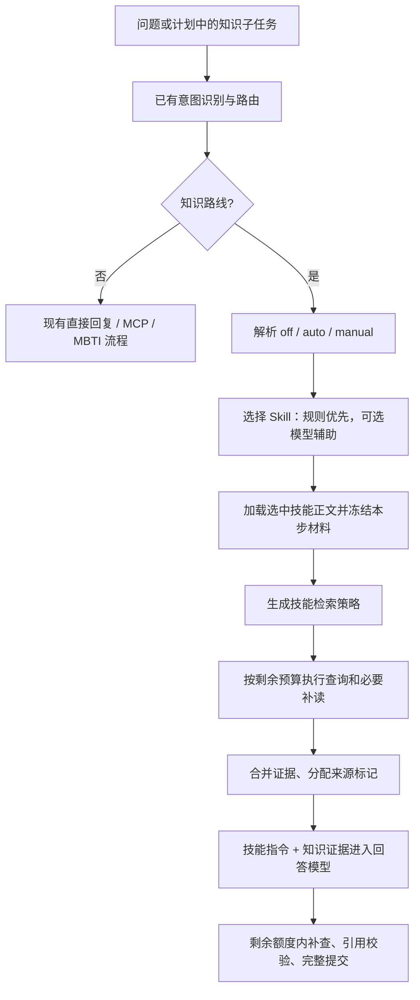

# 自动 Skill 选择与技能检索策略：开发 TODO

本次只创建说明和详细 TODO，没有实现自动选择、策略执行或新的请求字段，也没有运行测试、语法检查、模型或服务。现有系统仍采用手动 Skill，普通请求保持原行为。

## 目标与现状

目前 `runner.prepare_question()` 先执行一次固定混合检索，`prepare_model_turn()` 才通过 `prepare_skill()` 加载用户选中的技能。因此，要让技能影响首次检索，必须调整执行顺序，而不只是增加一段提示词。

目标流程如下，图中新增节点均待开发：

选择时只提供技能 ID、名称和描述；回答时才提供所选技能的完整指令。技能说明不进入向量库，也不能作为回答的知识来源。

## 新文件及建议开发顺序

| 顺序 | 文件 | 本次状态 | 下一步职责 |
| --- | --- | --- | --- |
| 1 | [`agent/skill_selector.py`](src/knowledge_agent/agent/skill_selector.py) | 说明及 TODO 01—15 | 请求模式、规则选择、可选模型分类、回退与预算 |
| 2 | [`knowledge/skill_retrieval.py`](src/knowledge_agent/knowledge/skill_retrieval.py) | 说明及 TODO 01—17 | 三种技能的查询策略、执行、证据聚合与预算 |
| 3 | 本文的接入 TODO A01—A12 | 待开发 | 接回运行器、多步计划、API、CLI、存储及页面 |
| 4 | 本文及两个模块末尾的验证项 | 待统一执行 | 开发完成后验证，不边开发边调用真实模型 |

可以先从 `skill_selector.py` 的 TODO 01—04 开始，明确请求和选择结果的数据契约，再完成规则选择。接口稳定后开发检索策略，最后统一接入入口和页面。

## 请求模式与兼容性

规划新增可选 `skill_mode`，不把旧 `skill_id=null` 自动改成启用技能：

| 请求 | 规划行为 |
| --- | --- |
| 不传 mode，不传 ID / ID 为 null | `off`，保持原普通问答 |
| 不传 mode，提供 ID | `manual`，保持原手动选择 |
| `skill_mode="off"`，不提供 ID | 明确禁用技能选择与技能策略 |
| `skill_mode="auto"`，不提供 ID | 自动选择，可回退为普通问答 |
| `skill_mode="manual"`，提供合法 ID | 使用用户指定的技能 |
| auto/off 搭配 ID，或 manual 缺少 ID | 参数错误，不静默调整 |

第一版页面增加“自动选择”选项，保留“普通问答”和现有三个手动技能；保持现有普通问答默认值，由用户显式切换自动模式。选择算法配置为 `rules/hybrid`：默认规则，hybrid 才允许规则无法明确决定时增加一次模型分类。

## 技能策略的实际差异

| Skill | 查询策略 | 材料不足时 |
| --- | --- | --- |
| `concept-explanation` | 概念 + 用户关注点；必要且有额度时补用途或示例 | 说明未覆盖的点，不机械凑齐完整教程 |
| `concept-comparison` | 对两项明确对象分别检索相同关注点，并保留两侧归属 | 对象不明确先澄清；仅有一侧证据则只回答有依据部分 |
| `code-explanation` | 从可见代码提取关键 API/类/函数，针对疑问查询文档；必要时补读章节 | 无可见代码时请求片段；不猜任意本地路径中的内容 |
| 普通 / 自动回退 / 无专门策略的合法技能 | 复用原单次混合检索 | 沿用既有资料不足或服务失败处理 |

第一版不增加查询生成模型，不修改全局 `top_k`，不引入重排模型或新向量数据库。多个查询复用现有混合检索，并在同一索引版本下合并证据。

## 现有文件接入 TODO

- [ ] **A01：在 `config.py` 规划选择器设置。** 定义并校验 `SkillSelectionSettings`，包括 rules/hybrid、候选数量、元数据/历史字符上限。未来通过 `.env.example` 说明配置；本次不修改实际 `.env`。这些是选择器的局部限制，不增加独立于 `AgentConfig` 的模型或工具预算。

- [ ] **A02：扩展 `skill_loader.py` 的分层加载。** 保留 `discover_skills/load_skill/prepare_skill`；增加接收已加载快照的准备路径或等价接口。自动选择后首次检索前确认正文可用，回答准备时复用同一份材料。auto 加载失败回退普通，manual 失败保留明确错误；正文始终不能扩张工具白名单。不要把读取文件元数据等同于把全文发送给模型。

- [ ] **A03：改造 `_ask_single()` 知识分支。** 将模式标准化与选择接在 `resolve_route()` 之后、`prepare_question()` 首次检索之前。非知识分支不自动选择；已有手动 Skill 与单独 MCP 请求的冲突规则继续明确反馈。选择的模型调用计入原 `intent_model_calls` 之后的累计数，传递到检索与回答。对外 `ask()` / `KnowledgeAgentApplication.ask()` 新参数使用可选默认值，保持旧调用方式。

- [ ] **A04：改造 `prepare_question()` 初检入口。** 目前这里直接 `tool_calls += 1` 后执行一次搜索，需要接收检索策略和剩余工具/追加搜索预算，统一“执行前检查、实际调用前计数”。替换原固定搜索，不在它前后重复附加策略搜索。聚合全部查询后再判断成功/部分/空/失败，构造一次最终证据上下文。更新 `PreparedQuestion` 等内部数据，让选择、已加载技能、策略摘要和累计成本能传给回答准备。

- [ ] **A05：接入 `_run_planned_step()`。** 对每个实际执行的 knowledge 步骤分别应用 auto/manual/off；MCP 子步骤跳过。传入本步目标和必要的已完成依赖，不把第一步选中的技能延用到所有步骤。选择调用、策略查询和回答循环全部扣减 `StepBudget`，在 `StepOutcome` 中返回真实累计；规划调用已消耗的额度不可重置。预算不足以模型分类时先回退规则/普通，保留回答额度；已跳过步骤不选择技能。

- [ ] **A06：统一 `tools/knowledge.py` 与 `tools/registry.py` 的计数和执行边界。** 复用两种现有工具执行器，每次实际查询/补读消耗一次总工具调用；每个知识步骤首个搜索以外的搜索，无论程序还是模型发起，都消耗追加搜索次数。现有 `registry.execute_tool_calls()` 已负责部分计数，策略不能重复扣费。通过统一程序调用回调或共享预算接口落实，保留完整错误与 trace。检索策略不能递归调用 planner。

- [ ] **A07：调整 `prepare_model_turn()` 与三个 `SKILL.md` 的衔接。** 准备提示时直接复用选中技能快照和已执行的策略摘要；明确哪些资料已提供、哪些目标尚缺证据，避免模型机械重复检索。技能允许的工具取固定白名单交集。三个技能的说明都补“优先利用当前策略结果，再按缺口补查”，继续只输出本轮 `[S1]`。本次尚未修改这些正文。

- [ ] **A08：扩展公开摘要和执行记录。** 在 `schemas.py` 规划可选 `skill` 摘要：请求模式、显式 ID、选中 ID、选择来源、固定原因码、策略 ID、实际执行/跳过次数与覆盖缺口。保留 `selected`、`prepared`、`applied` 的区别；选择器模型调用不能被标成技能已用于回答。`trace.py` 增加选择/策略阶段时，同步 Literal、允许值集合及序列化。公开摘要不包含全部技能提示、用户代码、证据全文或模型推理。

- [ ] **A09：同步逐步计划与持久化。** 多步计划每步保存对应的技能/策略摘要，不用 `TurnTrace.applied_skill_id` 的最后一个值概括全轮。更新 `planner.validate_plan_summary()` 的严格字段白名单为向后兼容的可选扩展，并更新 `plan_executor` 构造结果的位置。`session_store.py` 的结果 JSON 校验、恢复、API 当前回答/历史类型和 CLI 公共 JSON 转换保持一致。旧记录没有新增字段时默认 None；仅增加可选 JSON 字段时不需要新增数据库表。只在原完整轮次提交时持久化，不单独写入半轮选择状态。

- [ ] **A10：贯通 API 与 CLI 请求。** `api.py` 的 `AskRequest` 增加可选 mode 和组合校验，经 `ServiceRuntime.ask`、worker、application、Agent 完整传递；检查现有 `skill_id is None` 分支，避免漏传 auto/off。`/skills` 继续只返回可用目录，不触发选择模型。CLI 的 ask/chat 后续增加 `--skill-mode` 与 `--skill`，默认维持旧普通模式；开启聊天模式的选择可作用于后续各轮，但每轮的自动结果独立。

- [ ] **A11：更新网页交互与结果展示。** 下拉列表明确区分自动、普通和手动技能，发送 mode + ID，不再仅依赖空 ID 区分全部状态。自动模式无匹配、预算不足或服务回退时显示“普通问答”及简短原因；只有实际应用后才显示已使用技能。多步任务按步骤显示所选技能和策略。MBTI 按钮继续显式使用普通模式；刷新历史只展示保存的选择结果，不重新选择或检索。

- [ ] **A12：更新开发说明与待验证范围。** 在 `README.md` 和 `INTENT_PLANNING.md` 说明两阶段上下文加载、选择成本、检索差异、模式兼容性及计划内预算。在真实实现完成前保持“待开发”标记，不把本次 TODO 文件的存在写成自动技能已经启用。现有完成实现但仍写“待开发”的模块头注释可逐项纠正，不擅自删除尚未执行的验证 TODO。

## 预算与证据的共同约束

1. 默认整轮上限继续是 4 次模型调用、6 次工具调用、2 次追加搜索、24,000 字符证据及依赖上下文。自动分类不能给每个子任务补发新额度。
2. 比较策略分别查 A/B 是两次搜索：首次 1 次工具，第二次 1 次工具 + 1 次追加搜索。只够一次时用联合查询并如实标记，不能显示两次完成。
3. 每个知识步骤自己的第一条搜索算初检，但计划所有步骤的总工具及追加搜索次数仍共用上限；章节补读消耗总工具及上下文，不算搜索。
4. 所有返回值按索引版本与片段 ID 去重，不直接跨查询比较融合分数；来源元数据保持原样，只有实际送入模型的片段才有可引用标记。
5. 查询覆盖标签描述“取得了哪些材料”，不能证明结论正确；没有检索到某项说明也不能断言该功能不存在。

## 待统一验证清单（本次不执行）

- [ ] 旧请求、新模式及非法参数组合；普通和手动模式不增加自动分类调用。
- [ ] 三类代表问题的规则选择与 hybrid 回退；引用代码/否定要求不会变成工具授权。
- [ ] 两阶段加载：选择时只传元数据，回答时只传选中技能正文。
- [ ] 三种策略产生可观察的查询差异；联合查询、两侧独立查询和预算跳过区分准确。
- [ ] 单轮与多步共享预算；选择超时计数、预算不足跳过分类、检索失败不无限重试。
- [ ] 空结果、部分故障、缺少代码、缺少比较对象及版本不一致分别处理。
- [ ] 来源去重、上下文裁剪与 `[S1]` 校验；知识策略不访问任意文件或执行代码。
- [ ] 当前回答、历史、CLI JSON、页面逐步摘要兼容旧数据；没有真实通过结论时不填“通过”。
