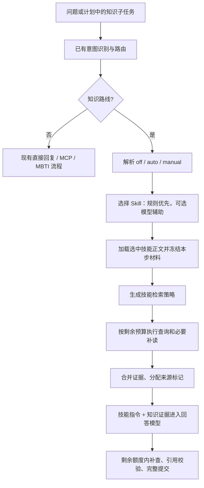

# 自动 Skill 选择与技能检索策略：实现记录与待验收项

自动选择、策略执行、模式字段、Agent/API/CLI/页面接入和实时阶段进度已完成代码开发。**本次未运行测试、语法检查、模型或服务；下方勾选仅表示实现，不代表验收通过。** 效果评估、请求标识和断线恢复暂缓。

## 目标与现状

`agent/preparation.py` 的 `prepare_question()` 在确认知识路线后、首次检索前选择技能，加载并冻结本步正文，再执行差异化检索。`prepare_model_turn()` 复用同一份技能材料，不在检索之后重新选择。普通问答仍使用默认检索。

本文件从根目录归档到 `project_docs/`，代码拆分后的对应关系见 [目录迁移说明](README.md#本次目录迁移)。文内代码路径相对项目源码包，链接则相对此文档；本次目录整理未执行测试或联调。

当前代码流程如下，运行结果待统一验证：

选择时只提供技能 ID、名称和描述；回答时才提供所选技能的完整指令。技能说明不进入向量库，也不能作为回答的知识来源。

## 新文件及建议开发顺序

| 顺序 | 文件 | 本次状态 | 下一步职责 |
| --- | --- | --- | --- |
| 1 | [`agent/skill_selector.py`](../src/knowledge_agent/agent/skill_selector.py) | 已实现，未验证 | 请求模式、规则选择、可选模型分类、回退与预算 |
| 2 | [`knowledge/skill_retrieval.py`](../src/knowledge_agent/knowledge/skill_retrieval.py) | 已实现，未验证 | 三种技能的查询策略、执行、证据聚合与预算 |
| 3 | 本文的接入 A01—A12 | 已实现，未验证 | 运行器、多步计划、API、CLI、存储及页面 |
| 4 | 本文及两个模块末尾的验证项 | 待统一执行 | 开发完成后验证，不边开发边调用真实模型 |

共享的 `knowledge/code_analysis.py` 提取围栏或裸 Python 代码，供选择器与检索器使用。它只分析可见文本，不读取路径或执行代码。

## 请求模式与兼容性

新增可选 `skill_mode`，不把旧 `skill_id=null` 自动改成启用技能：

| 请求 | 代码行为 |
| --- | --- |
| 不传 mode，不传 ID / ID 为 null | `off`，保持原普通问答 |
| 不传 mode，提供 ID | `manual`，保持原手动选择 |
| `skill_mode="off"`，不提供 ID | 明确禁用技能选择与技能策略 |
| `skill_mode="auto"`，不提供 ID | 自动选择，可回退为普通问答 |
| `skill_mode="manual"`，提供合法 ID | 使用用户指定的技能 |
| auto/off 搭配 ID，或 manual 缺少 ID | 参数错误，不静默调整 |

第一版页面增加“自动选择”选项，保留“普通问答”和现有三个手动技能；保持现有普通问答默认值，由用户显式切换自动模式。选择算法配置为 `rules/hybrid`：默认规则，hybrid 才允许规则无法明确决定时增加一次模型分类。

## 技能策略的实际差异

| Skill | 查询策略 | 材料不足时 |
| --- | --- | --- |
| `concept-explanation` | 概念 + 用户关注点；必要且有额度时补用途或示例 | 说明未覆盖的点，不机械凑齐完整教程 |
| `concept-comparison` | 对两项明确对象分别检索相同关注点，并保留两侧归属 | 对象不明确先澄清；仅有一侧证据则只回答有依据部分 |
| `code-explanation` | 从可见代码提取关键 API/类/函数，针对疑问查询文档；必要时补读章节 | 无可见代码时请求片段；不猜任意本地路径中的内容 |
| 普通 / 自动回退 / 无专门策略的合法技能 | 复用原单次混合检索 | 沿用既有资料不足或服务失败处理 |

第一版不增加查询生成模型，不修改全局 `top_k`，不引入重排模型或新向量数据库。多个查询复用现有混合检索，并在同一索引版本下合并证据。

## 接入实现记录

- [x] **A01：选择器配置。** `config.get_skill_selection_settings()` 读取 rules/hybrid、目录与历史上限；`.env.example` 提供示例，实际 `.env` 未修改。共享原 Agent 预算。

- [x] **A02：加载快照。** `prepare_skill(loaded_skill=...)` 复用检索前加载的正文；自动加载失败回退普通，手动非法 ID 继续报错。目录文件读取不等于全文进入模型上下文。

- [x] **A03：单轮接入。** 公开 ask 接受可选模式；在路由后的知识准备流程中选择，非知识分支跳过。选择尝试计入意图识别之后的累计模型调用。

- [x] **A04：策略初检与裁剪。** 聚合多次查询后构造证据；最终再用实际 `source_map` 收敛覆盖摘要，裁剪掉的片段不计入模型可用证据。

- [x] **A05：逐步计划接入。** 每个执行的知识子任务独立选择并共享 StepBudget；MCP 和跳过的步骤不选择。仅在足够保留一次回答时允许 hybrid 分类，分类不重试。

- [x] **A06：工具预算。** 程序策略调用原执行器并计数，模型调用由 registry 计数；同一步首次查询以外的检索计入追加搜索，不重复计数。

- [x] **A07：技能正文。** 三个技能先使用当前策略结果，再按实际内容缺口补查。查询尝试、词面命中与事实充分性分别解释；继续只引用本轮 `[S1]`。

- [x] **A08：公开执行记录。** 本版复用 trace，不另增重复的 AnswerResult.skill。新增 skill_select/skill_retrieval 阶段及可选模式、选中 ID、策略和 step_id；选择、准备、应用分别记录，不包含正文、代码或模型推理。详细检索覆盖摘要只进入本步回答上下文。

- [x] **A09：逐步展示与存储。** 本版保持 PlanSummary 结构，通过 trace 事件 step_id 关联各步骤技能，页面逐步展示，CLI JSON 保留事件。新可选字段沿原 result_json 保存，旧记录默认 None，无表迁移。

- [x] **A10：API 与 CLI。** 请求模式及组合校验贯通 worker、application 和 Agent；ask/chat 增加 --skill-mode 与 --skill，旧请求默认行为保留。

- [x] **A11：网页与实时进度。** 增加自动选项，MBTI 按钮明确 off；SSE progress 实时展示公开阶段，result/error 结束本轮。历史按保存的事件展示，不重新选择，也不自动重连或重发。

- [x] **A12：文档。** README 与 INTENT_PLANNING 已同步实现方式，保留下面未执行的验证清单。

## 预算与证据的共同约束

1. 默认整轮上限继续是 4 次模型调用、6 次工具调用、2 次追加搜索、24,000 字符证据及依赖上下文。自动分类不能给每个子任务补发新额度。
2. 比较策略分别查 A/B 是两次搜索：首次 1 次工具，第二次 1 次工具 + 1 次追加搜索。只够一次时用联合查询并如实标记，不能显示两次完成。
3. 每个知识步骤自己的第一条搜索算初检，但计划所有步骤的总工具及追加搜索次数仍共用上限；章节补读消耗总工具及上下文，不算搜索。
4. 所有返回值按索引版本与片段 ID 去重，不直接跨查询比较融合分数；来源元数据保持原样，只有实际送入模型的片段才有可引用标记。
5. 查询覆盖标签描述“取得了哪些材料”，不能证明结论正确；没有检索到某项说明也不能断言该功能不存在。

## 待统一验证清单（本次不执行）

- [ ] 旧请求、新模式及非法参数组合；普通和手动模式不增加自动分类调用。
- [ ] 三类代表问题的规则选择与 hybrid 回退；引用代码/否定要求不会变成工具授权。
- [ ] 两阶段加载：选择时只传元数据，回答时只传选中技能正文。
- [ ] 三种策略产生可观察的查询差异；联合查询、两侧独立查询和预算跳过区分准确。
- [ ] 单轮与多步共享预算；选择超时计数、预算不足跳过分类、检索失败不无限重试。
- [ ] 空结果、部分故障、缺少代码、缺少比较对象及版本不一致分别处理。
- [ ] 来源去重、上下文裁剪与 `[S1]` 校验；知识策略不访问任意文件或执行代码。
- [ ] 当前回答、历史、CLI JSON、页面逐步摘要兼容旧数据；没有真实通过结论时不填“通过”。
- [ ] 裸代码、Python 围栏、只有文件路径；问题所指 API 的优先级与导入别名解析。
- [ ] 联合比较只返回单边材料，以及候选命中但最终上下文裁剪掉一边时，覆盖不误报完整。
- [ ] SSE 分段 UTF-8、心跳、业务错误、保存失败、断连清理和慢客户端；断连不自动重发，旧 JSON 接口保留。
