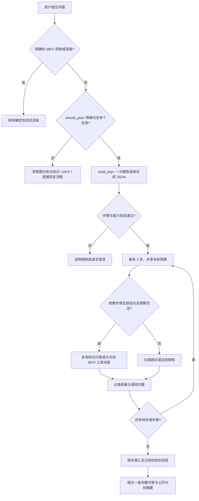

# 意图边界与多步骤任务规划

本文说明本次两项开发：区分咨询问题与工具操作，以及在同一轮问答中执行有依赖关系的多个任务。**本次只开发，未运行测试、语法检查、服务、页面或模型联调，也未安装依赖；下文描述代码行为与使用方式，不代表已经验收通过。**

本文件已从根目录归档至 `project_docs/`，代码职责和路径调整见 [目录迁移说明](README.md#本次目录迁移)。启动命令及知识库 `docs/` 位置不变，本次整理也未执行测试。

## 1. 区分咨询与操作

意图识别先判断用户是否明确发出操作指令，再决定是否进入工具流程。提到工具名称、MBTI 或评分，不应单独成为执行工具的依据。

| 输入 | 处理方向 |
| --- | --- |
| “如何实现 MBTI 评分？” | Python / LangChain 相关的实现咨询，进入知识问答，不读取测试结果 |
| “如何实现暂停 MBTI 测试的功能？” | 实现咨询，不改变当前测试状态 |
| “开始 MBTI 测试” | 进入现有确定性问卷流程 |
| “暂停 MBTI 测试” | 保存并暂停当前测试 |
| “继续 MBTI 测试” | 根据当前会话恢复测试进度 |
| “查看 MBTI 结果” | 查询当前会话的测试结果；未完成题目时不补造答案 |
| “退出 MBTI 测试” | 退出当前测试 |
| 答题卡提交的 `MBTI答题 <test_id> <question_id> <value>` | 校验测试和题号后提交选项 |

控制指令按完整语义匹配；咨询、否定、引用或教程中的操作词不会仅因命中关键词就执行。普通知识追问沿用最近的知识上下文，继续答题则使用会话内单独保存的测试状态。中途询问知识问题不会自行填写答案，也不会清空问卷进度。

单独的“继续”等短句需要结合上下文判断；缺少可确定的继续对象时，应请求澄清。没有开始测试时，单独的数字不能凭空创建一个测试。暂停、退出等操作也不由通用模型自行猜测参数。

相关文件：

- [`agent/assessment.py`](../src/knowledge_agent/agent/assessment.py)：完整控制指令与测试状态转换。
- [`agent/intent.py`](../src/knowledge_agent/agent/intent.py)：知识咨询、工具请求、追问与直接回复的意图边界。
- [`agent/router.py`](../src/knowledge_agent/agent/router.py)：根据有效意图和当前可用工具确定执行路线。
- [`agent/runner.py`](../src/knowledge_agent/agent/runner.py)：将会话状态与上述节点接入一次问答。

## 2. 在一轮内执行多个步骤

后续增量已接入自然语言工具子句：例如“先解释什么是栈，再在B站搜索数据结构”。原始子句通过同一意图入口取得授权，规划模型不能改写子句或转移工具权限；B 站语义补充、共享预算和长对话摘要的最新用例见 [三项功能说明](SEMANTIC_PLANS_MEMORY.md)。本次增量仍未运行验证。

新增 [`agent/planner.py`](../src/knowledge_agent/agent/planner.py)，把明确包含多个任务的问题转换为受约束的步骤列表，再由宿主程序执行。简单问题继续使用原有问答流程，不为每个问题额外调用规划模型。

### 规划和执行的职责

`should_plan` 识别明确的多个任务，例如“先……再……最后……”。`build_plan` 最多调用一次模型，要求它返回结构化 JSON；宿主校验步骤编号、目标、依赖、能力与工具范围后才执行。计划最多包含 3 个步骤，不递归调用规划器，也不因规划失败无限重试。

每个步骤使用现有 `knowledge` 或 `mcp` 能力。知识步骤仍通过文档检索取得证据，并执行来源引用校验；MCP 步骤仍受实际注册的工具白名单和参数校验约束。规划器不能注册新工具、扩大权限或绕过必填参数。缺少必要信息时返回澄清，不能把模型推测当作用户提供的工具参数。

请求设为 `skill_mode=auto` 时，每个实际执行的知识步骤在首次检索前独立选择 Skill，加载并冻结本步技能正文，再按对应策略检索。手动指定技能则用于各知识步骤，`off` 使用普通检索。MCP 和 MBTI 不运行自动技能选择。规划、意图与可选技能分类均共享原模型预算；分类失败或额度不足时回退普通问答，不给每步重发预算。

MBTI 的开始、逐题答题、暂停、恢复和评分继续由确定性流程管理，不混入自动计划。类型描述这类独立只读工具可以在明确指定工具和参数的任务中使用，但不能代替收集测试答案。

### 共享预算

整个请求使用同一份原有 `AgentConfig` 限制，不为每个子步骤重新发放预算。默认值如下；修改配置后以实际配置为准。

| 资源 | 默认本轮上限 | 说明 |
| --- | --- | --- |
| 模型调用 | 4 次 | 包含规划调用与所有执行步骤中的模型调用 |
| 工具调用 | 6 次 | 包含实际执行的检索与 MCP 工具调用 |
| 追加检索 | 2 次 | 在各知识步骤之间共享 |
| 证据及依赖上下文 | 24,000 字符 | 控制检索材料和依赖步骤传递内容的规模 |
| 计划步骤 | 3 个 | 每个步骤只由宿主按计划顺序处理一次 |

达到限制时保留已经完成的内容，明确记录剩余步骤的状态。请求里列出了三个任务，不代表系统可以在当前预算内完成三个任务。

### 依赖与部分完成

步骤可声明依赖前面的步骤。只有依赖步骤均为 `success` 时，依赖它的步骤才继续；资料不足、需要澄清、服务异常或达到预算，都不会作为成功前提传给下一步。

如果某一步失败，不依赖它且预算仍充足的其他步骤可以继续。依赖失败的步骤标记为 `skipped`，最终回答保留已经取得的结果，并说明尚未完成的部分。计划摘要可为 `completed`、`partial`、`failed` 或 `needs_clarification`，不能把跳过的步骤显示成已完成。

最后按步骤汇总各步骤已经完成引用校验的答案，不额外调用模型润色汇总，避免增加调用成本或在汇总时引入没有来源的新结论。整个计划只形成一条用户问答；子步骤不会各自产生新的用户聊天轮次。

目前实现的是**本轮内按依赖状态调度**。尚未实现模型根据执行结果自动重写计划，也没有后台持续规划、无限重试或跨轮自动恢复并重执行任务。

## 使用示例

以下为开发后的使用示例，均未在本次开发中运行。

### 多个知识任务

> 先解释 RAG，再比较向量检索与关键词检索，最后给我安排学习步骤。

该请求具有明确的任务顺序，适合进入规划。执行内容仍取决于知识库是否包含相关资料，以及剩余调用预算；学习步骤必须基于可用资料，资料不足时应说明缺口。

### 明确工具参数的跨能力任务

> 先调用 MCP 工具 `mcp__mbti__get_mbti_description`，参数 `type_code` 为 `INTJ`；再解释 Python 中如何把一次函数调用封装成可复用函数。

第一个任务明确指定工具和参数，第二个任务使用 Python 知识库。MCP 服务需要已连接且该工具在白名单内。这里的人格类型只用于查询类型描述，不据此推断学习能力，也不让类型描述替代 Python 文档证据。

### 保持原流程的简单问题

> 什么是 RAG？

简单知识问题仍走原检索与回答流程。单独的“开始 MBTI 测试”仍进入现有测试流程，不生成任务计划。

## 保存与页面展示

[`schemas.py`](../src/knowledge_agent/schemas.py) 的 `AnswerResult.plan` 记录公开摘要，包含版本、整体状态及步骤列表。每一步仅保存编号、目标、执行方式、依赖、结果状态、调用次数和停止原因，不包含模型内部推理或完整工具响应。

[`session_store.py`](../src/knowledge_agent/session_store.py) 在原 `turns.result_json` 中保存可选的 `plan` 字段；读取旧记录时该字段为 `None`，无需新增数据库或升级表结构。摘要跟随可保存的完整问答轮一起提交，原有服务失败、达到调用上限、会话写入失败等未保存结果规则继续适用。

[`http/`](../src/knowledge_agent/http/) 的当前回答与历史接口均返回同一类型的 `plan`，无需新增 API 路径；[`api.py`](../src/knowledge_agent/api.py) 保留兼容启动入口。路由仍为 `knowledge`、`mcp`、`direct` 三种；多步骤结果使用现有路由，并以 `multi_step_plan` 说明执行原因。

网页回答下方的“任务执行步骤”展示各步骤目标、依赖、状态、调用次数，以及从带 `step_id` 的 trace 读取的技能模式、选择原因、检索策略和是否进入回答模型。顶层最近一次技能状态不代表全部步骤。技能信息作为 trace 的可选事件字段保存在原结果 JSON，旧记录无需补写。

等待期间通过新增 SSE 提问接口实时显示公开阶段进度；最终完整答案和计划摘要仍在校验后返回。展开历史只查看保存的摘要，不重新执行计划。未保存结果继续显示“本轮未保存”。本次不新增模型自动改写计划、请求 ID 或断线恢复。

## 后续统一验收范围

本次未执行以下验证，后续统一验收时再进行：

- 咨询评分、暂停功能的编程问题不会错误触发 MBTI 操作。
- 测试中切换知识话题后，显式继续测试能恢复原进度。
- 简单问题保持原流程，明确多任务请求生成最多 3 步。
- 知识步骤保持来源校验；MCP 步骤保持白名单和参数校验。
- 依赖失败时正确跳过，独立步骤仍受剩余预算约束。
- 预算不足时保留部分回答，并准确显示未完成步骤。
- 计划只提交一条用户问答，刷新页面能读取已保存摘要，旧历史正常显示。
